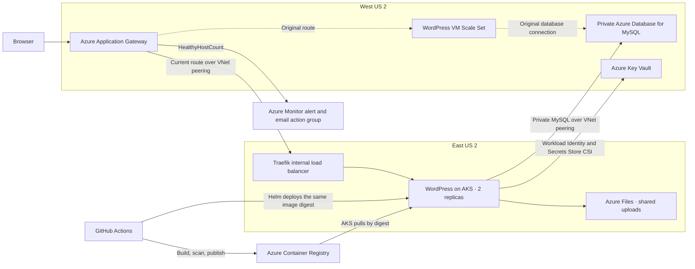

# WordPress on Azure

The migration kept the public Application Gateway URL and the private MySQL
database. Application Gateway now sends traffic to Traefik in AKS. Both
WordPress replicas mount the same Azure Files share for uploads.

The AKS cluster runs in East US 2 because the West US 2 regional vCPU
quota was already in use during provisioning. The two regions communicate
through VNet peering. Both WordPress replicas run on one AKS node, so the
lab demonstrates pod replication and shared storage without node-level
redundancy.